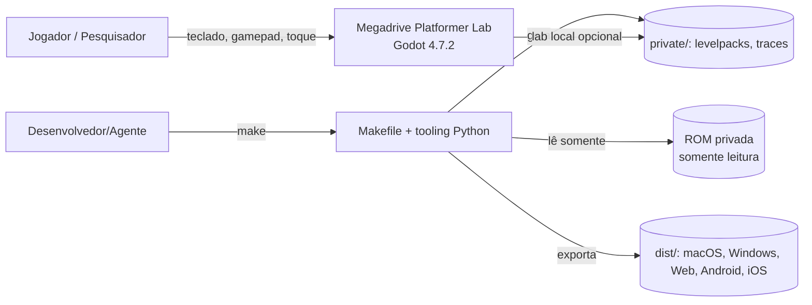
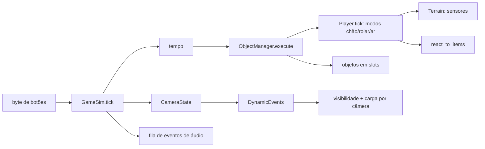

# C4 — Contexto, Contêineres e Componentes

## Contexto


## Contêineres
```mermaid
flowchart TB
  subgraph Tooling[tooling/ (Python stdlib)]
    RA[rom_analyze] --> LED[(ledger CSV)]
    EMU[m68k + mdmachine] --> EX[extract_data]
    EMU --> RT[reference_trace]
    GH[rea_tools: REA/Ghidra em sandbox]
    PAR[parity] --> REP[(reports/)]
    GT[godot_tasks: run/export/testes]
  end
  subgraph Game[game/ (Godot)]
    BOOT[bootstrap/main.gd]
    SIM[simulation: GameSim, Player, Terrain, Camera, Objects]
    REN[render_modes: WorldView, VramArt, GeometryArt, SpritePainter]
    UI[ui: overlay, pixel_font]
    IN[input: InputRouter, TouchLogic/Overlay]
    AU[audio: AudioBus]
    SV[saves: Settings]
  end
  EX --> PRIV[(levelpacks)]
  RT --> TR[(traces)]
  PAR -->|replay_runner.gd headless| SIM
  BOOT --> SIM & REN & UI & IN & AU & SV
```

## Componentes da simulação

