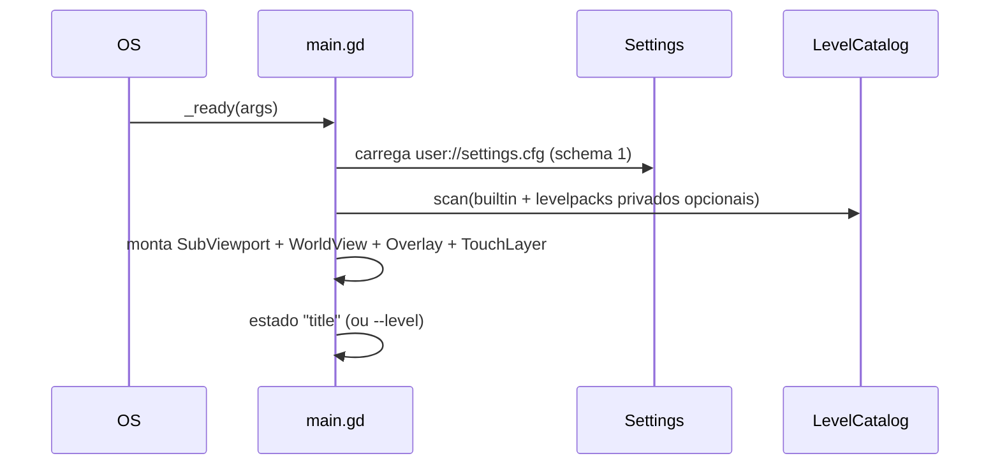
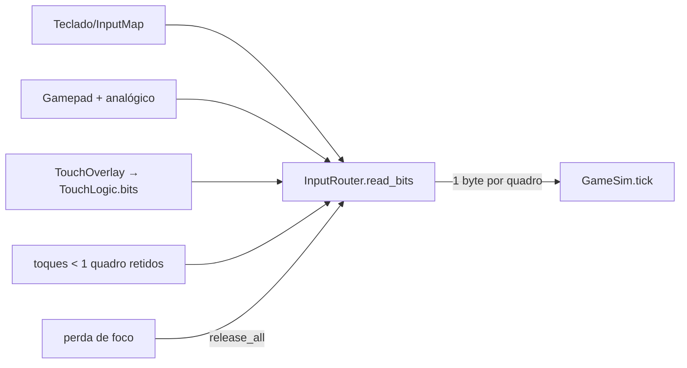
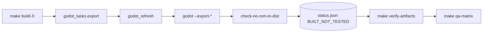

# Fluxos (Mermaid)

## Boot


## Entrada → simulação


## Laço do jogo (tick fixo)
```mermaid
flowchart TD
  F[_process(delta)] --> A[acc += min(delta,0.25)]
  A --> W{acc >= 1/60 e passos < 4?}
  W -- sim --> T[sim.tick(bits)] --> E[AudioBus.handle_events] --> A2[acc -= 1/60] --> W
  W -- não --> D[WorldView/Overlay redesenham o estado atual]
```

## Persistência
`Settings.save_settings()` grava ConfigFile com seção `meta.schema=1`; schema diferente → padrões (sem migração destrutiva).

## Render
Perfil Fidelity: SubViewport 320×224, escala inteira, filtro nearest; arte da VRAM privada se houver, senão arte própria.
Perfil Enhanced: 640×448, filtro linear, arte própria, parallax procedural. Ambos leem o mesmo GameSim.

## Export

